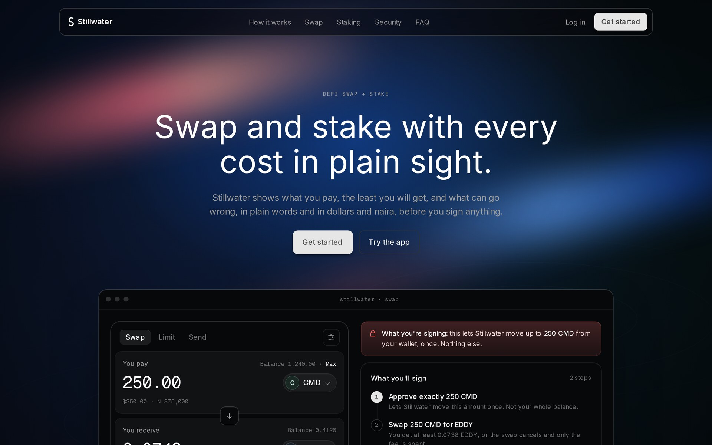
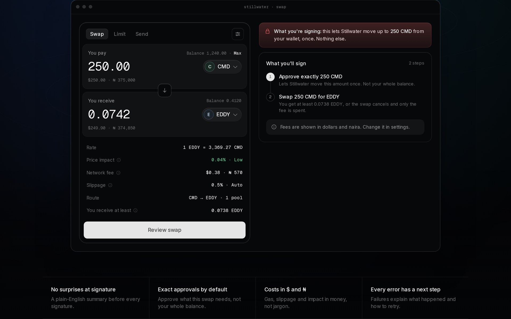
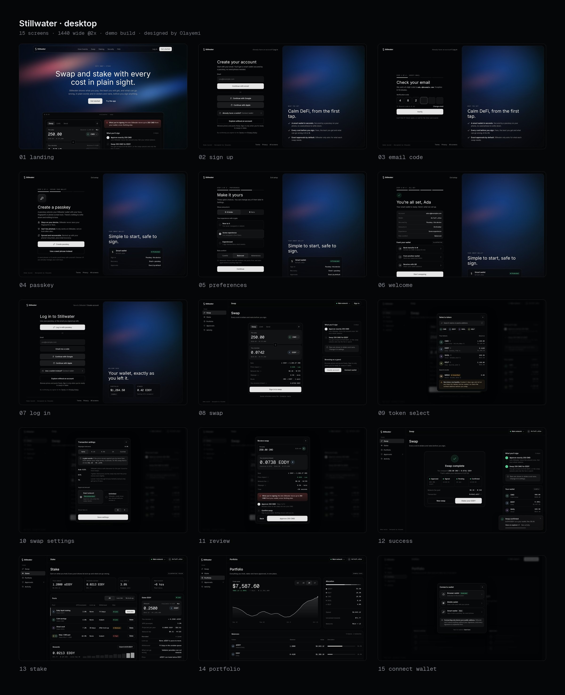
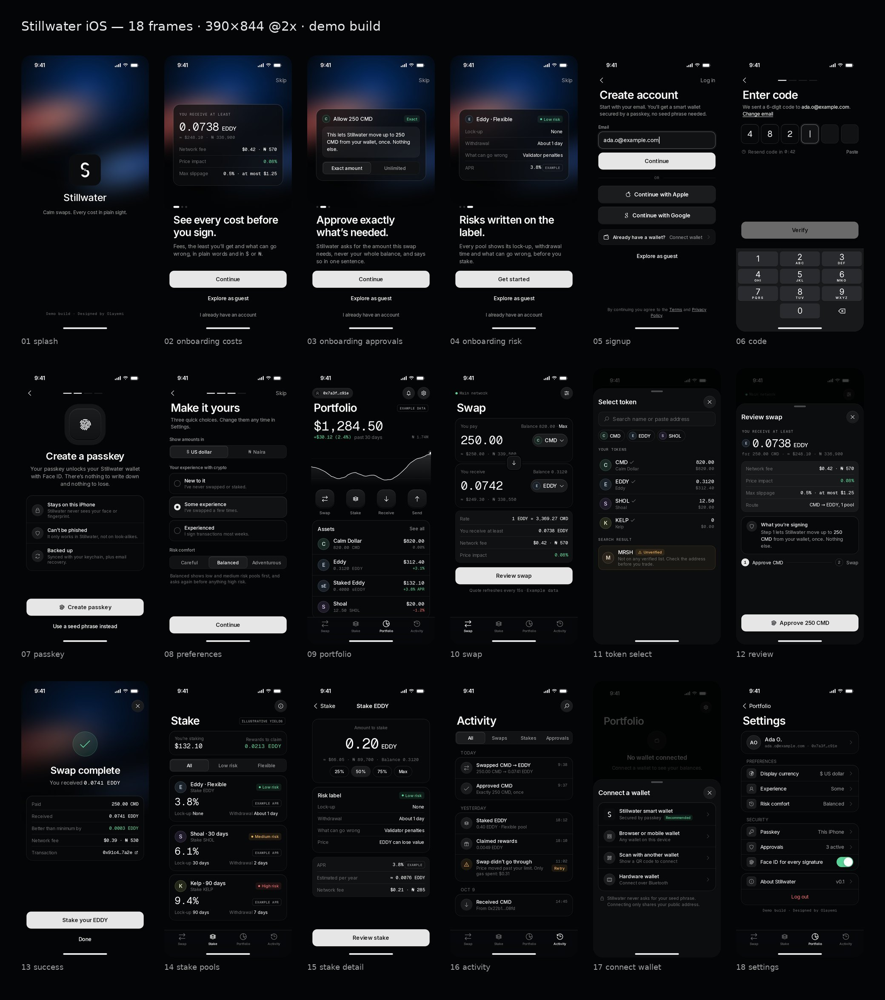

# Stillwater — demo DeFi swap & stake app, designed by Olayemi

**Demo build · Designed by Olayemi**

Swap and stake with every cost and risk in plain sight. Stillwater is a calm DeFi swap and stake app by **Olayemi**, a product designer in Lagos: a responsive marketing site, a full web app flow and an 18-screen iOS app, all coded from her design.

**Live demo:** https://stillwater-concept.sites.tab.bot/





> All tokens (CMD, EDDY, sEDDY, SHOL, KELP, MRSH), prices, yields, addresses and transactions are fictional examples. Stillwater is a demo build and does not connect to any chain or wallet.

## Features

- **Guest-first swap.** Quotes, rates and pools are free to browse without an account; the swap button reads "Sign in to swap".
- **Costs in $ and ₦.** Gas, slippage and price impact are shown as money, not percentages alone.
- **No surprises at signature.** A plain-English summary before every signature: "This lets Stillwater move up to 250 CMD from your wallet, once. Nothing else."
- **Exact approvals by default.** Approve what the swap needs, not the whole balance.
- **A risk label on every pool:** lock-up, withdrawal time, what can go wrong, and price.
- **Every error has a next step.**
- **Full sign-up flow:** email, Google, Apple or wallet; 6-digit email code; passkey for the smart wallet; currency, experience and risk preferences; welcome and funding.
- **Portfolio:** balances, a chart, activity and token approvals you can revoke.

## Screens

### Desktop



### Mobile app



The 18 iOS frames (390×844, exported at 2x) are in [`mobile/screens/`](mobile/screens/): splash, three onboarding steps, sign-up, code, passkey, preferences, portfolio, swap, token select, review, success, stake pools, stake detail, activity, connect wallet and settings.

## Pages

Each page has its own URL, and every page is responsive (designed at 1440 px desktop and 390 px mobile).

| Page | Live |
|---|---|
| Landing page (with motion) | [/landing/](https://stillwater-concept.sites.tab.bot/landing/) |
| Sign up: email, Google, Apple, connect wallet | [/app/signup/](https://stillwater-concept.sites.tab.bot/app/signup/) |
| Sign up: 6-digit email code with resend timer | [/app/signup-verify/](https://stillwater-concept.sites.tab.bot/app/signup-verify/) |
| Sign up: create a passkey for the smart wallet | [/app/signup-passkey/](https://stillwater-concept.sites.tab.bot/app/signup-passkey/) |
| Sign up: $/₦ currency, experience, risk comfort | [/app/signup-preferences/](https://stillwater-concept.sites.tab.bot/app/signup-preferences/) |
| Sign up: welcome, fund your wallet | [/app/signup-welcome/](https://stillwater-concept.sites.tab.bot/app/signup-welcome/) |
| Log in | [/app/login/](https://stillwater-concept.sites.tab.bot/app/login/) |
| Swap (guest): quote, rate, fees in $ and ₦, minimum received | [/app/swap/](https://stillwater-concept.sites.tab.bot/app/swap/) |
| Swap: token select with unverified-token warning | [/app/swap-token-select/](https://stillwater-concept.sites.tab.bot/app/swap-token-select/) |
| Swap: slippage and approval settings | [/app/swap-settings/](https://stillwater-concept.sites.tab.bot/app/swap-settings/) |
| Swap: review with plain-English signing summary | [/app/swap-review/](https://stillwater-concept.sites.tab.bot/app/swap-review/) |
| Swap: success | [/app/success/](https://stillwater-concept.sites.tab.bot/app/success/) |
| Stake: pools, stake panel, risk label, rewards | [/app/stake/](https://stillwater-concept.sites.tab.bot/app/stake/) |
| Portfolio: balances, chart, activity, approvals | [/app/portfolio/](https://stillwater-concept.sites.tab.bot/app/portfolio/) |
| Connect wallet | [/app/connect/](https://stillwater-concept.sites.tab.bot/app/connect/) |

The [index page](https://stillwater-concept.sites.tab.bot/) lists every screen. Add `?figma=1` to any URL to turn motion off and show each page in its final state (handy for importing into Figma with html.to.design).

## Design system

**Colour.** Near-black surfaces with hairline borders and one warm accent.

| Token | Value | Use |
|---|---|---|
| Void / Ink | `#040506` / `#07080a` | Page and app background |
| Obsidian / Graphite | `#111214` / `#1b1c1e` | Cards and wells |
| Ash / Mist | `#9c9c9d` / `#e6e6e6` | Secondary and primary text |
| Coral | `#ff6363` | The single accent: primary actions only |
| Sky | `#63a1ff` | Links and info |
| OK / Warn / Risk | `#59d499` / `#f2b552` / `#f06a6a` | Status and risk labels |
| Line | `rgba(255,255,255,.08)` | Hairline borders |

**Type.** Inter for the interface and headlines; Geist Mono for numbers, amounts and addresses, so figures line up. Both are self-hosted.

**Shape.** Radii from 6 px (chips) through 16 px (cards) to 20 px (panels), soft keycap-style inset shadows on controls, and a 1200 px content width.

**Token badges.** Plain letter monograms: a circle with a faint, desaturated tint per token, a hairline border and the token's letters in Inter SemiBold (CMD → C, EDDY → E, sEDDY → sE, SHOL → S, KELP → K, MRSH → M). One helper, `ti()` in `tools/build.py`, draws every badge on the site and in the mobile frames, including pair badges (two overlapped circles).

**Logo.** "Waterline S": an S made of two identical halves that meet at a level line. It lives in one file, `site/assets/mark.svg` (it uses `currentColor`), and the build generates the favicons, touch icon and app icon from it.

**Icons.** Line Awesome, as local SVGs in `site/assets/icons/`, inlined into each page.

## Motion

Built with GSAP 3.15 (ScrollTrigger and SplitText), self-hosted in `site/assets/vendor/` and set up inside `gsap.matchMedia()`, so everything reverts for visitors who prefer reduced motion.

- **Hero intro:** headline lines rise out of a mask, then the copy and buttons fade up out of a soft blur.
- **Hero app window:** rises in and flattens from a tilt as you scroll; its rows stagger in.
- **Statement:** words brighten as you scroll through them.
- **How it works:** a hairline fills across the three steps as you scroll.
- **Number tickers:** APRs, stats and the portfolio total count up when they come into view.
- **Letter roll** on buttons and links: each letter slides up one row (520 ms, `cubic-bezier(.22,.61,.36,1)`, 18 ms stagger).
- **Micro-interactions:** magnetic primary buttons, a cursor-following card glow, a sliding pill on segmented controls, smooth FAQ open and close, a copy-address tick, a success check that draws itself on, and a portfolio chart line that draws in.
- **Calm water background:** a small canvas of slow, drifting cool light with faint ripples, paused when offscreen.

Everything is readable without JavaScript.

## Run it locally

No framework and no build step are needed to view it:

```bash
cd site
python3 -m http.server 8000
# open http://localhost:8000
```

To change the pages, edit the shared parts in `tools/build.py` and regenerate:

```bash
python3 tools/build.py        # rebuilds site/ (PNG icons need rsvg-convert)
python3 mobile/build_mobile.py  # rebuilds the mobile frames in mobile/frames/
node --test                   # runs the checks in test/
```

The mobile frames are plain HTML at 390×844; open any file in `mobile/frames/` in a browser, or export them at 2x for 780×1688 PNGs.

## Project structure

```
site/        the deployable static site (landing page + app pages)
  assets/    styles.css (design tokens and components), motion.js, fonts, icons, GSAP
tools/       build.py, the page generator
test/        checks for pages, links, assets and motion
mobile/      the iOS app: app.css, build_mobile.py, frames/ (HTML) and screens/ (PNG)
media/       images for this README
```

## Credits

- Product design and direction: **Olayemi**
- Icons: [Line Awesome](https://icons8.com/line-awesome) by Icons8
- Motion: [GSAP](https://gsap.com/) by GreenSock (ScrollTrigger, SplitText), self-hosted
- Fonts: [Inter](https://rsms.me/inter/) and [Geist Mono](https://vercel.com/font), both under the SIL Open Font License
- Style inspired by Raycast's design language; motion inspired by Visuvate. No assets, logos or code were copied from either.

Tokens, prices and numbers are fictional examples. Demo build, 2026.
